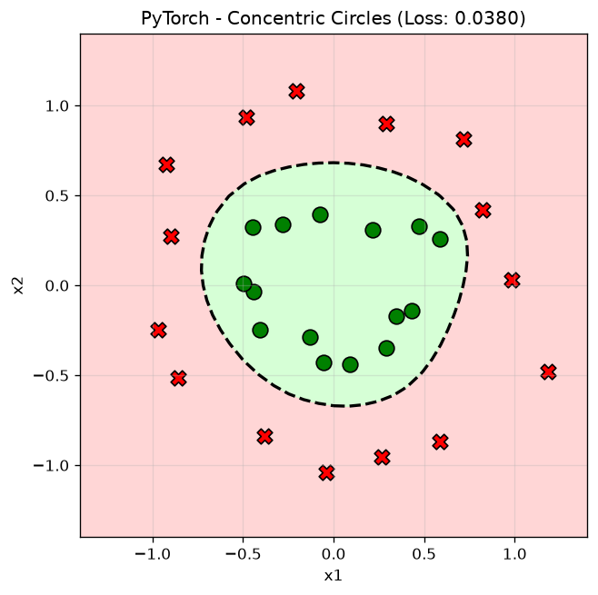

# MicroGradient 

Mạng nơ-ron đa tầng (MLP) và cơ chế lan truyền ngược (backpropagation / autograd engine) tối giản viết bằng Python thuần (lấy cảm hứng từ [micrograd](https://github.com/karpathy/micrograd)), song song với phiên bản đối chứng triển khai bằng thư viện **PyTorch**.

Dự án áp dụng thử nghiệm trên **bài toán phi tuyến phân loại điểm hình tròn đồng tâm 2D** (`concentric circles`).

---

## Kết quả trực quan & So sánh

Mô hình phân loại nhị phân các điểm thuộc 2 vòng tròn đồng tâm (tập dữ liệu `make_circles` từ `scikit-learn`). Đường phân chia phi tuyến (decision boundary) học được sau **200 epochs** (`learning_rate = 0.15`):

| Micrograd (Python) | PyTorch |
| :---: | :---: |
|  |  |
| **Loss:** ~0.012 \| **Accuracy:** 100% (30/30) | **Loss:** ~0.038 \| **Accuracy:** 100% (30/30) |

- **Kiến trúc mạng**: MLP 2 lớp ẩn `[2, 8, 8, 1]` (tổng cộng 105 tham số weights & biases).
- **Hàm kích hoạt**: `tanh`.
- **Hàm mất mát**: Mean Squared Error (MSE).
- **Trình tối ưu**: Gradient Descent (SGD) với `lr = 0.15`.

---

## Cấu trúc thư mục

```text
MicroGradient/
├── engine.py                   # Lớp Value hỗ trợ scalar autograd & đồ thị tính toán
├── nn.py                       # Các module Neuron, Layer, MLP (thuần Python)
├── main.py                     # Huấn luyện mô hình bằng Micrograd tự xây dựng
├── main_pytorch.py             # Huấn luyện mô hình đối chứng bằng PyTorch
├── requirements.txt            # Danh sách thư viện phụ thuộc
├── decision_boundary.png       # Biểu đồ kết quả Micrograd
├── decision_boundary_pytorch.png # Biểu đồ kết quả PyTorch
├── .gitignore                  # Bỏ qua venv, cache và file hệ thống
└── README.md                   # Tài liệu hướng dẫn dự án
```

---

## Cài đặt & Chạy thử nghiệm

### 1. Khởi tạo & Kích hoạt môi trường ảo

```bash
# Windows
python -m venv venv
.\venv\Scripts\activate

# Linux / macOS
python3 -m venv venv
source venv/bin/activate
```

### 2. Cài đặt các thư viện cần thiết

```bash
pip install -r requirements.txt
```

### 3. Chạy thử nghiệm

- **Chạy phiên bản Micrograd (Python thuần):**
  ```bash
  python main.py
  ```
  *(Biểu đồ ranh giới phân loại sẽ được lưu vào file `decision_boundary.png`)*

- **Chạy phiên bản PyTorch:**
  ```bash
  python main_pytorch.py
  ```
  *(Biểu đồ ranh giới phân loại sẽ được lưu vào file `decision_boundary_pytorch.png`)*
