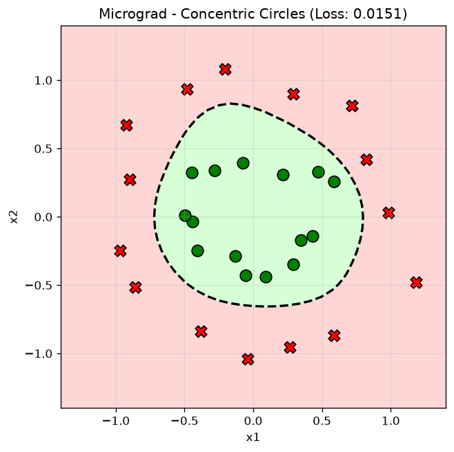

# MicroGradient 🧠

Mạng nơ-ron (MLP) tối giản viết bằng Python ([micrograd](https://github.com/karpathy/micrograd)), phục vụ mục đích học tập cơ chế lan truyền ngược (backpropagation) và tính toán gradient tự động.

Dự án áp dụng thử nghiệm trên **bài toán phi tuyến phân loại điểm hình tròn đồng tâm 2D** (`concentric circles`).

---

## 🎯 Kết quả trực quan

Mô hình phân loại nhị phân các điểm thuộc 2 vòng tròn đồng tâm (tập dữ liệu `make_circles` từ `scikit-learn`). Đường phân chia phi tuyến (decision boundary) học được sau 200 epochs:

<p align="center">
  
</p>

- **Kiến trúc mạng**: MLP 2 lớp ẩn `[2, 8, 8, 1]` (tổng cộng 105 tham số weights & biases).
- **Hàm kích hoạt**: `tanh`.
- **Hàm mất mát**: Mean Squared Error (MSE).
- **Kết quả**: Đạt độ chính xác **100% (30/30 mẫu)**.
---

## 🚀 Cài đặt & Chạy thử nghiệm

### 1. Khởi tạo môi trường ảo

```bash
# Windows
python -m venv venv
.\venv\Scripts\activate

# Linux / macOS
python3 -m venv venv
source venv/bin/activate
```

### 2. Cài đặt thư viện

```bash
pip install -r requirements.txt
```

### 3. Huấn luyện mô hình

```bash
python main.py
```

Sau khi chạy xong, chương trình sẽ in quá trình huấn luyện theo từng epoch và xuất file biểu đồ `decision_boundary.png`.

